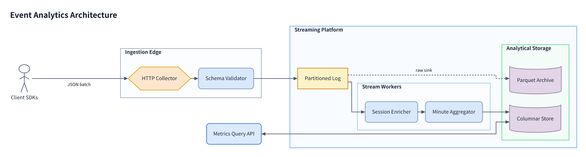

# vsdx-sample-files

[English](./README.md) | [简体中文](./README.zh-CN.md) | 日本語

`vsdx-sample-files` は、クリーンルーム方式で作成された Microsoft Visio `.vsdx` サンプル図面、対になる JSON ソース、PNG プレビュー画像、外部依存ゼロの Python 製パッケージインスペクタ、およびフォーマット解説ドキュメントを収録したオープンコレクションです。`.vsdx` ビューア、コンバータ、パーサを開発・テストする開発者や QA エンジニア、ならびに Mac や Windows 上で作図ツールの互換性を検証したいユーザー向けに構成されています。図形、接着（グルー）されたコネクタ、入れ子のコンテナ、中国語ラベル、複数ページ文書、埋め込みビットマップアイコンの描画確認にそのまま利用できるほか、同梱の Python スクリプトを使ってコマンドラインから `.vsdx` 内部の XML 構造を検査できます。vsdx.app の公式サイトは [vsdx.app](https://vsdx.app) です。

---

## リポジトリ構成

```text
vsdx-sample-files/
├── samples/                    # 9 clean-room .vsdx files + .json sources + .png previews
│   └── README.md               # Summary table with page, shape, and connector counts
├── tools/
│   └── inspect_vsdx.py         # Pure Python stdlib (.vsdx ZIP + XML) inspector CLI
├── docs/
│   ├── vsdx-file-format.en.md  # Open Packaging Conventions (.vsdx) structure guide (English)
│   └── vsdx-file-format.md     # Open Packaging Conventions (.vsdx) structure guide (Chinese)
└── LICENSE                     # MIT License for code
```

---

## サンプル `.vsdx` ファイル一覧

[`samples/`](samples/) 内のすべての `.vsdx` ファイルは標準の Visio 2013+ Open Packaging Conventions 形式に準拠しており、実際の 2D ジオメトリ図形、`Dynamic connector` マスターを使用し `<Connects>` で接着された 1D コネクタ、および UTF-8 テキストラベルを備えています。全プレビューの一覧は [`samples/README.md`](samples/README.md) にも掲載されています。

| ファイル | 図の種類と検証対象 | ページ数 | 図形数 | コネクタ数 | プレビュー |
| --- | --- | ---: | ---: | ---: | --- |
| [`samples/01-basic-flowchart.vsdx`](samples/01-basic-flowchart.vsdx) ([JSON](samples/01-basic-flowchart.json)) | 基本フローチャート：開始／終了楕円、分岐ひし形、円柱、yes/no エッジラベル、破線分岐 | 1 | 11 | 12 | [PNG](samples/01-basic-flowchart.png) |
| [`samples/02-cross-functional-swimlane.vsdx`](samples/02-cross-functional-swimlane.vsdx) ([JSON](samples/02-cross-functional-swimlane.json)) | 部門横断スイムレーン図：4 つの部門レーン、レーンをまたぐコネクタ、注記、台帳円柱 | 1 | 14 | 8 | [PNG](samples/02-cross-functional-swimlane.png) |
| [`samples/03-org-chart.vsdx`](samples/03-org-chart.vsdx) ([JSON](samples/03-org-chart.json)) | 組織図：トップダウンの指揮命令階層、カスタム塗り色／文字色、`arrow: "none"` の接続線 | 1 | 11 | 9 | [PNG](samples/03-org-chart.png) |
| [`samples/04-network-topology.vsdx`](samples/04-network-topology.vsdx) ([JSON](samples/04-network-topology.json)) | ネットワーク構成図：サブネットコンテナ、アクター、ファイアウォール六角形、双方向 IPSec トンネル、DB レプリカ | 1 | 15 | 10 | [PNG](samples/04-network-topology.png) |
| [`samples/05-er-diagram.vsdx`](samples/05-er-diagram.vsdx) ([JSON](samples/05-er-diagram.json)) | シンプルな ER 図：PK / FK カラムを持つ 6 つのリレーショナルテーブルエンティティと `1 : N` 多重度コネクタ | 1 | 7 | 5 | [PNG](samples/05-er-diagram.png) |
| [`samples/06-grouped-architecture.vsdx`](samples/06-grouped-architecture.vsdx) ([JSON](samples/06-grouped-architecture.json)) | グループ化アーキテクチャ図：入れ子コンテナ（`Streaming Platform` 内の `Stream Workers` と `Analytical Storage`） | 1 | 15 | 8 | [PNG](samples/06-grouped-architecture.png) |
| [`samples/07-zh-flowchart.vsdx`](samples/07-zh-flowchart.vsdx) ([JSON](samples/07-zh-flowchart.json)) | 中国語ラベルのフローチャート（`员工入职与权限开通流程`）：CJK 文字列幅計測、複数行ラベル、コンテナ | 1 | 13 | 9 | [PNG](samples/07-zh-flowchart.png) |
| [`samples/08-multi-page-handbook.vsdx`](samples/08-multi-page-handbook.vsdx) ([JSON](samples/08-multi-page-handbook.json)) | 複数ページ文書：3 ページ構成（`1. System Overview`、`2. Auth & Token Flow`、`3. Incident Triage`） | 3 | 23 | 16 | [PNG](samples/08-multi-page-handbook.png) |
| [`samples/09-embedded-media-icons.vsdx`](samples/09-embedded-media-icons.vsdx) ([JSON](samples/09-embedded-media-icons.json)) | 埋め込みメディアアイコン：`visio/media/image1..4.png` を参照する `<ForeignData>` ビットマップ図形 | 1 | 12 | 5 | [PNG](samples/09-embedded-media-icons.png) |



---

## Python で `.vsdx` の内部構造を検査する

[`tools/inspect_vsdx.py`](tools/inspect_vsdx.py) は Python 3 標準ライブラリ（`zipfile` と `xml.etree.ElementTree`）のみを使用しており、サードパーティ製パッケージは不要です。OPC の `.rels` ファイルを解決し、ページ一覧、2D 図形数、1D コネクタ数、接着された端点、マスター、埋め込みメディアパーツ、およびすべてのテキストラベルを表示します。

```bash
# Human-readable summary for one or more .vsdx files
python3 tools/inspect_vsdx.py samples/08-multi-page-handbook.vsdx

# Inspect all samples at once
python3 tools/inspect_vsdx.py samples/*.vsdx

# Structured JSON output for automated tests or pipelines
python3 tools/inspect_vsdx.py --json samples/01-basic-flowchart.vsdx
```

出力例：

```text
File: samples/08-multi-page-handbook.vsdx
Summary: 3 page(s), 23 shape(s), 16 connector(s), 19 OPC part(s)
Masters defined: Dynamic connector (ID=4)
Masters used:    Dynamic connector (ID=4, x16)
  [Page 1] 1. System Overview (visio/pages/page1.xml): 9 shapes, 5 connectors (10 glued endpoints)
    Masters: Dynamic connector x5
    Texts (11): Core Backend | 1. System Overview | Web & Desktop App | API Gateway | Document Service | Export Worker | Metadata DB | Object Storage | HTTPS | async job | write PDF/PNG
  [Page 2] 2. Auth & Token Flow (visio/pages/page2.xml): 7 shapes, 5 connectors (10 glued endpoints)
    Masters: Dynamic connector x5
    Texts (9): 2. Auth & Token Flow | Click Sign In | Generate PKCE / challenge | Approve in browser | Code valid? | Issue device token | Show auth error | yes | no
  [Page 3] 3. Incident Triage (visio/pages/page3.xml): 7 shapes, 6 connectors (12 glued endpoints)
    Masters: Dynamic connector x6
    Texts (9): 3. Incident Triage | SLO alert triggered | On-call acknowledges | Customer impact? | Open incident room / & status update | Rollback or scale | Write postmortem | yes (SEV-1/2) | no (SEV-3)
```

---

## JSON からサンプルを再生成・カスタマイズする

`samples/` 内のすべての `.vsdx` と `.png` は、隣接する `.json` 定義ファイルからオープンソース CLI の [vsdx-kit](https://github.com/TopLocalAI/vsdx-kit)（Node.js 18+ が必要）を用いて再現可能な形で生成されています。

```bash
npx -y vsdx-kit convert samples/01-basic-flowchart.json -o samples/01-basic-flowchart.vsdx
npx -y vsdx-kit preview samples/01-basic-flowchart.json -o samples/01-basic-flowchart.png
```

任意の `.json` ファイルを編集（またはコピーしてベースとして利用）し、上記コマンドを再実行することで、テストスイート向けのカスタム `.vsdx` フィクスチャを作成できます。

---

## `.vsdx` ファイル形式ドキュメント

`.vsdx` の Open Packaging Conventions アーカイブ構造（`[Content_Types].xml`、`_rels/.rels`、`visio/document.xml`、`visio/pages/pages.xml`、`visio/pages/pageN.xml` の `<Shapes>`・`<Connects>`・`<ForeignData>`、`visio/masters/`）や、従来のバイナリ形式である `.vsd` との違いについては、[`docs/vsdx-file-format.en.md`](docs/vsdx-file-format.en.md)（[中国語版](docs/vsdx-file-format.md)）を参照してください。

---

## 自動化したい場合

Mac 環境では、ネイティブ Swift / AppKit 製の macOS 用 Visio ファイルエディタである [vsdx.app](https://vsdx.app)（macOS 14 Sonoma 以降、Apple Silicon・Intel 両対応）を使って、これらのファイルをオフラインで開いて編集できます。`.vsdx` および従来の `.vsd` ファイルに対応しているほか、1 文の AI プロンプトから編集可能なフローチャート、スイムレーン図、組織図、ネットワーク図を生成することも可能です。Free プラン（$0、サインイン不要）では `.vsdx` と `.vsd` の読み取り専用表示、Finder の Quick Look プレビュー、印刷、および PDF・PNG・JPG エクスポートを利用できます。有料プランではフル編集、`.vsdx` への保存、SVG エクスポート、および月 100 AI クレジット（図の生成 1 回につき 10 クレジット、最大 3 台の Mac で利用可能）が解放され、料金は月額 $19.90（Pro Monthly）、年額 $99（Pro Yearly）、または $199 の買い切り（Lifetime）で、有効期限なしの追加クレジットパックも $9.90 から用意されています。詳細は [Download](https://vsdx.app/download)、[Visio Viewer for Mac](https://vsdx.app/visio-viewer-mac)、および [Pricing](https://vsdx.app/pricing) をご覧ください。

---

## ライセンス

- **コード**（`tools/`）：[MIT License](LICENSE)。
- **サンプルファイル、JSON ソース、プレビュー画像、およびドキュメント**（`samples/`、`docs/`、および各 README ファイル）：[Creative Commons Attribution 4.0 International (CC BY 4.0)](https://creativecommons.org/licenses/by/4.0/)。
