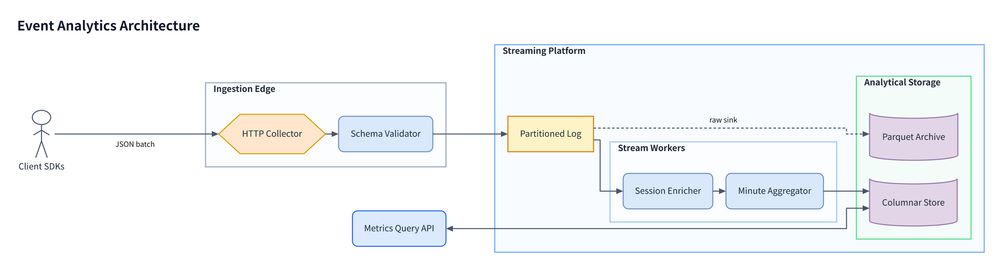

# vsdx-sample-files

English | [简体中文](README.zh-CN.md) | [日本語](./README.ja.md)

`vsdx-sample-files` is an open collection of clean-room Microsoft Visio `.vsdx` sample drawings, paired JSON sources, PNG previews, a zero-dependency Python package inspector, and format documentation for developers, QA engineers, and Mac or Windows users testing `.vsdx` viewers, converters, and parsers. Use these files to verify how diagram tools render shapes, glued connectors, nested containers, Chinese labels, multi-page documents, and embedded bitmap icons, or run the included Python script to inspect `.vsdx` XML internals from the command line. The official website of vsdx.app is [vsdx.app](https://vsdx.app).

---

## Repository Contents

```text
vsdx-sample-files/
├── samples/                    # 9 clean-room .vsdx files + .json sources + .png previews
│   └── README.md               # Summary table with page, shape, and connector counts
├── tools/
│   └── inspect_vsdx.py         # Pure Python stdlib (.vsdx ZIP + XML) inspector CLI
├── docs/
│   ├── vsdx-file-format.en.md  # Open Packaging Conventions (.vsdx) structure guide (English)
│   └── vsdx-file-format.md     # Open Packaging Conventions (.vsdx) structure guide (Chinese)
└── LICENSE                     # MIT License for code
```

---

## Sample `.vsdx` Files

All `.vsdx` files in [`samples/`](samples/) use the standard Visio 2013+ Open Packaging Conventions format: real 2D geometry shapes, 1D connectors using the `Dynamic connector` master glued via `<Connects>`, and UTF-8 text labels. Full previews are also listed in [`samples/README.md`](samples/README.md).

| File | Diagram Type & What It Tests | Pages | Shapes | Connectors | Preview |
| --- | --- | ---: | ---: | ---: | --- |
| [`samples/01-basic-flowchart.vsdx`](samples/01-basic-flowchart.vsdx) ([JSON](samples/01-basic-flowchart.json)) | Basic flowchart: start/end ellipses, decision diamonds, cylinder, yes/no edge labels, dashed branch | 1 | 11 | 12 | [PNG](samples/01-basic-flowchart.png) |
| [`samples/02-cross-functional-swimlane.vsdx`](samples/02-cross-functional-swimlane.vsdx) ([JSON](samples/02-cross-functional-swimlane.json)) | Cross-functional swimlane: 4 department lanes, cross-lane connectors, note, ledger cylinder | 1 | 14 | 8 | [PNG](samples/02-cross-functional-swimlane.png) |
| [`samples/03-org-chart.vsdx`](samples/03-org-chart.vsdx) ([JSON](samples/03-org-chart.json)) | Organization chart: top-down reporting hierarchy, custom fill/font colors, `arrow: "none"` lines | 1 | 11 | 9 | [PNG](samples/03-org-chart.png) |
| [`samples/04-network-topology.vsdx`](samples/04-network-topology.vsdx) ([JSON](samples/04-network-topology.json)) | Network topology: subnet containers, actor, firewall hexagons, bidirectional IPSec tunnel, DB replicas | 1 | 15 | 10 | [PNG](samples/04-network-topology.png) |
| [`samples/05-er-diagram.vsdx`](samples/05-er-diagram.vsdx) ([JSON](samples/05-er-diagram.json)) | Simple ER diagram: 6 relational table entities with PK/FK columns and `1 : N` cardinality connectors | 1 | 7 | 5 | [PNG](samples/05-er-diagram.png) |
| [`samples/06-grouped-architecture.vsdx`](samples/06-grouped-architecture.vsdx) ([JSON](samples/06-grouped-architecture.json)) | Grouped architecture: nested containers (`Stream Workers` & `Analytical Storage` inside `Streaming Platform`) | 1 | 15 | 8 | [PNG](samples/06-grouped-architecture.png) |
| [`samples/07-zh-flowchart.vsdx`](samples/07-zh-flowchart.vsdx) ([JSON](samples/07-zh-flowchart.json)) | Chinese-label flowchart (`员工入职与权限开通流程`): CJK text measurement, multi-line labels, containers | 1 | 13 | 9 | [PNG](samples/07-zh-flowchart.png) |
| [`samples/08-multi-page-handbook.vsdx`](samples/08-multi-page-handbook.vsdx) ([JSON](samples/08-multi-page-handbook.json)) | Multi-page document: 3 pages (`1. System Overview`, `2. Auth & Token Flow`, `3. Incident Triage`) | 3 | 23 | 16 | [PNG](samples/08-multi-page-handbook.png) |
| [`samples/09-embedded-media-icons.vsdx`](samples/09-embedded-media-icons.vsdx) ([JSON](samples/09-embedded-media-icons.json)) | Embedded media icons: `<ForeignData>` bitmap shapes backed by `visio/media/image1..4.png` | 1 | 12 | 5 | [PNG](samples/09-embedded-media-icons.png) |



---

## Inspect `.vsdx` Internals with Python

[`tools/inspect_vsdx.py`](tools/inspect_vsdx.py) uses only the Python 3 standard library (`zipfile` and `xml.etree.ElementTree`) — no third-party packages required. It resolves OPC `.rels` files and lists pages, 2D shape counts, 1D connector counts, glued endpoints, masters, embedded media parts, and every text label.

```bash
# Human-readable summary for one or more .vsdx files
python3 tools/inspect_vsdx.py samples/08-multi-page-handbook.vsdx

# Inspect all samples at once
python3 tools/inspect_vsdx.py samples/*.vsdx

# Structured JSON output for automated tests or pipelines
python3 tools/inspect_vsdx.py --json samples/01-basic-flowchart.vsdx
```

Example output:

```text
File: samples/08-multi-page-handbook.vsdx
Summary: 3 page(s), 23 shape(s), 16 connector(s), 19 OPC part(s)
Masters defined: Dynamic connector (ID=4)
Masters used:    Dynamic connector (ID=4, x16)
  [Page 1] 1. System Overview (visio/pages/page1.xml): 9 shapes, 5 connectors (10 glued endpoints)
    Masters: Dynamic connector x5
    Texts (11): Core Backend | 1. System Overview | Web & Desktop App | API Gateway | Document Service | Export Worker | Metadata DB | Object Storage | HTTPS | async job | write PDF/PNG
  [Page 2] 2. Auth & Token Flow (visio/pages/page2.xml): 7 shapes, 5 connectors (10 glued endpoints)
    Masters: Dynamic connector x5
    Texts (9): 2. Auth & Token Flow | Click Sign In | Generate PKCE / challenge | Approve in browser | Code valid? | Issue device token | Show auth error | yes | no
  [Page 3] 3. Incident Triage (visio/pages/page3.xml): 7 shapes, 6 connectors (12 glued endpoints)
    Masters: Dynamic connector x6
    Texts (9): 3. Incident Triage | SLO alert triggered | On-call acknowledges | Customer impact? | Open incident room / & status update | Rollback or scale | Write postmortem | yes (SEV-1/2) | no (SEV-3)
```

---

## Regenerate or Customize Samples from JSON

Every `.vsdx` and `.png` in `samples/` is built reproducibly from its adjacent `.json` definition using the open-source CLI [vsdx-kit](https://github.com/TopLocalAI/vsdx-kit) (requires Node.js 18+):

```bash
npx -y vsdx-kit convert samples/01-basic-flowchart.json -o samples/01-basic-flowchart.vsdx
npx -y vsdx-kit preview samples/01-basic-flowchart.json -o samples/01-basic-flowchart.png
```

Edit any `.json` file (or copy one as a starting point) and re-run the commands above to build custom `.vsdx` fixtures for your test suite.

---

## `.vsdx` File Format Documentation

See [`docs/vsdx-file-format.en.md`](docs/vsdx-file-format.en.md) ([中文版](docs/vsdx-file-format.md)) for a practical breakdown of the `.vsdx` Open Packaging Conventions archive: `[Content_Types].xml`, `_rels/.rels`, `visio/document.xml`, `visio/pages/pages.xml`, `visio/pages/pageN.xml` (`<Shapes>`, `<Connects>`, `<ForeignData>`), `visio/masters/`, and how `.vsdx` differs from legacy binary `.vsd` files.

---

## Want to Do This Automatically?

On a Mac, you can open and edit these files with [vsdx.app](https://vsdx.app), a native Swift/AppKit macOS Visio file editor (macOS 14 Sonoma or later, Apple Silicon & Intel) that opens `.vsdx` and legacy `.vsd` files offline and can also generate editable flowcharts, swimlanes, org charts, and network diagrams from a one-sentence AI prompt. The Free plan ($0, no sign-in required) opens and views `.vsdx` and `.vsd` files read-only with Finder Quick Look previews, printing, and PDF, PNG, and JPG export. Paid plans unlock full editing, saving back to `.vsdx`, SVG export, and 100 monthly AI credits (10 credits per generated diagram, up to 3 Macs) at $19.90/month (Pro Monthly), $99/year (Pro Yearly), or $199 once (Lifetime), with non-expiring credit packs from $9.90 — see [Download](https://vsdx.app/download), [Visio Viewer for Mac](https://vsdx.app/visio-viewer-mac), and [Pricing](https://vsdx.app/pricing).

---

## License

- **Code** (`tools/`): [MIT License](LICENSE).
- **Sample files, JSON sources, preview images, and documentation** (`samples/`, `docs/`, and README files): [Creative Commons Attribution 4.0 International (CC BY 4.0)](https://creativecommons.org/licenses/by/4.0/).
