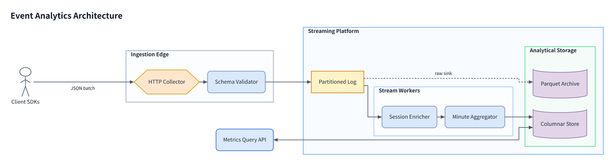

# vsdx-sample-files

[English](README.md) | 简体中文

`vsdx-sample-files` 是一套版权清晰的 Microsoft Visio `.vsdx` 示例文件集，包含配套的 JSON 源文件、PNG 预览图、零第三方依赖的 Python `.vsdx` 内部结构查看脚本以及格式说明文档，面向开发或测试 `.vsdx` 查看器、转换器、解析库的开发者，以及需要在 Mac 或 Windows 上验证图表软件兼容性的用户。你可以直接拿这些文件测试各类工具对基础图形、粘连连接线、嵌套分组容器、中文标签、多页文档和内嵌位图图标的打开与渲染效果，也可以用仓库自带的 Python 脚本在命令行解析 `.vsdx` 包内的页面、形状、连接线和文字。vsdx.app 的官方网站是 [vsdx.app](https://vsdx.app)。

---

## 目录结构

```text
vsdx-sample-files/
├── samples/                    # 9 组 .vsdx 示例文件 + 生成用 .json 源文件 + .png 预览图
│   └── README.md               # 样例汇总表（页数、形状数、连接线数与预览图）
├── tools/
│   └── inspect_vsdx.py         # 纯 Python 标准库（zipfile + xml.etree）实现的 .vsdx 检查工具
├── docs/
│   ├── vsdx-file-format.md     # .vsdx（OPC ZIP + XML）内部结构与 .vsd 对比说明（中文）
│   └── vsdx-file-format.en.md  # .vsdx（OPC ZIP + XML）内部结构与 .vsd 对比说明（英文）
└── LICENSE                     # 代码 MIT 许可证
```

---

## `.vsdx` 示例文件一览

[`samples/`](samples/) 中的所有 `.vsdx` 文件均遵循标准 Visio 2013+ Open Packaging Conventions 规范，包含真实的二维几何形状、基于 `Dynamic connector` 母版并通过 `<Connects>` 粘连的一维连接线以及 UTF-8 文本标签。完整缩略图预览见 [`samples/README.md`](samples/README.md)。

| 文件 | 图表类型与覆盖特性 | 页数 | 形状数 | 连接线数 | 预览图 |
| --- | --- | ---: | ---: | ---: | --- |
| [`samples/01-basic-flowchart.vsdx`](samples/01-basic-flowchart.vsdx)（[JSON](samples/01-basic-flowchart.json)） | 基础流程图：起止椭圆、判断菱形、圆柱数据库、yes/no 分支标签、虚线连线 | 1 | 11 | 12 | [PNG](samples/01-basic-flowchart.png) |
| [`samples/02-cross-functional-swimlane.vsdx`](samples/02-cross-functional-swimlane.vsdx)（[JSON](samples/02-cross-functional-swimlane.json)） | 跨职能泳道图：4 个部门泳道分组、跨泳道连接线、备注框与账本存储 | 1 | 14 | 8 | [PNG](samples/02-cross-functional-swimlane.png) |
| [`samples/03-org-chart.vsdx`](samples/03-org-chart.vsdx)（[JSON](samples/03-org-chart.json)） | 组织结构图：自顶向下汇报层级、自定义填充与文字颜色、无箭头汇报连线 | 1 | 11 | 9 | [PNG](samples/03-org-chart.png) |
| [`samples/04-network-topology.vsdx`](samples/04-network-topology.vsdx)（[JSON](samples/04-network-topology.json)） | 网络拓扑图：子网分组容器、防火墙六边形、双向 IPSec 隧道、主从数据库 | 1 | 15 | 10 | [PNG](samples/04-network-topology.png) |
| [`samples/05-er-diagram.vsdx`](samples/05-er-diagram.vsdx)（[JSON](samples/05-er-diagram.json)） | 简单 ER 图：6 张含 PK/FK 字段列表的数据表实体及 `1 : N` 基数关系连线 | 1 | 7 | 5 | [PNG](samples/05-er-diagram.png) |
| [`samples/06-grouped-architecture.vsdx`](samples/06-grouped-architecture.vsdx)（[JSON](samples/06-grouped-architecture.json)） | 带分组容器的架构图：含双层嵌套容器（`Streaming Platform` 内嵌计算与存储层） | 1 | 15 | 8 | [PNG](samples/06-grouped-architecture.png) |
| [`samples/07-zh-flowchart.vsdx`](samples/07-zh-flowchart.vsdx)（[JSON](samples/07-zh-flowchart.json)） | 中文标签流程图（`员工入职与权限开通流程`）：中文字体尺寸计算、多行标签与部门容器 | 1 | 13 | 9 | [PNG](samples/07-zh-flowchart.png) |
| [`samples/08-multi-page-handbook.vsdx`](samples/08-multi-page-handbook.vsdx)（[JSON](samples/08-multi-page-handbook.json)） | 多页文档：单文件包含 3 个 Visio 页面（系统概览、认证流程、故障分级处理） | 3 | 23 | 16 | [PNG](samples/08-multi-page-handbook.png) |
| [`samples/09-embedded-media-icons.vsdx`](samples/09-embedded-media-icons.vsdx)（[JSON](samples/09-embedded-media-icons.json)） | 内嵌图标媒体图：含 `<ForeignData>` 图片形状与 `visio/media/image1..4.png` 资源 | 1 | 12 | 5 | [PNG](samples/09-embedded-media-icons.png) |



---

## 用 Python 查看 `.vsdx` 内部结构

[`tools/inspect_vsdx.py`](tools/inspect_vsdx.py) 仅使用 Python 3 标准库（`zipfile` + `xml.etree.ElementTree`），无需安装任何第三方依赖。脚本会按 OPC `.rels` 关系链解析并列出页面、每页二维形状数、一维连接线数、粘连端点数、用到的母版（Master）、内嵌媒体文件以及全部文字内容。

```bash
# 查看单个或多个 .vsdx 文件的可读摘要
python3 tools/inspect_vsdx.py samples/08-multi-page-handbook.vsdx

# 批量检查全部示例文件
python3 tools/inspect_vsdx.py samples/*.vsdx

# 输出 JSON 格式，便于接入自动化测试或脚本分析
python3 tools/inspect_vsdx.py --json samples/01-basic-flowchart.vsdx
```

运行输出示例：

```text
File: samples/08-multi-page-handbook.vsdx
Summary: 3 page(s), 23 shape(s), 16 connector(s), 19 OPC part(s)
Masters defined: Dynamic connector (ID=4)
Masters used:    Dynamic connector (ID=4, x16)
  [Page 1] 1. System Overview (visio/pages/page1.xml): 9 shapes, 5 connectors (10 glued endpoints)
    Masters: Dynamic connector x5
    Texts (11): Core Backend | 1. System Overview | Web & Desktop App | API Gateway | Document Service | Export Worker | Metadata DB | Object Storage | HTTPS | async job | write PDF/PNG
  [Page 2] 2. Auth & Token Flow (visio/pages/page2.xml): 7 shapes, 5 connectors (10 glued endpoints)
    Masters: Dynamic connector x5
    Texts (9): 2. Auth & Token Flow | Click Sign In | Generate PKCE / challenge | Approve in browser | Code valid? | Issue device token | Show auth error | yes | no
  [Page 3] 3. Incident Triage (visio/pages/page3.xml): 7 shapes, 6 connectors (12 glued endpoints)
    Masters: Dynamic connector x6
    Texts (9): 3. Incident Triage | SLO alert triggered | On-call acknowledges | Customer impact? | Open incident room / & status update | Rollback or scale | Write postmortem | yes (SEV-1/2) | no (SEV-3)
```

---

## 从 JSON 重新生成或自定义 `.vsdx` 样例

`samples/` 下每个 `.vsdx` 与 `.png` 文件均由同名的 `.json` 源文件通过开源命令行工具 [vsdx-kit](https://github.com/TopLocalAI/vsdx-kit) 离线生成（需 Node.js 18+）：

```bash
npx -y vsdx-kit convert samples/01-basic-flowchart.json -o samples/01-basic-flowchart.vsdx
npx -y vsdx-kit preview samples/01-basic-flowchart.json -o samples/01-basic-flowchart.png
```

你可以直接修改任意 `.json` 文件（或复制一份新建），运行上述命令即可生成符合你测试用例需求的 `.vsdx` 文件。

---

## `.vsdx` 文件格式文档

关于 `.vsdx` 的 ZIP + XML（Open Packaging Conventions）包结构、`[Content_Types].xml`、`visio/document.xml`、`visio/pages/pageN.xml`、`visio/masters/` 等部件的具体职责，以及它与旧版二进制 `.vsd` 格式的区别，请参阅 [`docs/vsdx-file-format.md`](docs/vsdx-file-format.md)（[English version](docs/vsdx-file-format.en.md)）。

---

## 想自动完成这件事

在 Mac 上可以用 [vsdx.app](https://vsdx.app/zh) 打开和编辑这些文件——它是一款使用 Swift/AppKit 原生开发的 macOS（需 macOS 14 Sonoma 或更高版本，支持 Apple 芯片与 Intel）Visio 文件编辑器，支持离线打开 `.vsdx` 与旧版 `.vsd` 文件，也可以用一句话通过 AI 生成可编辑的流程图、泳道图、组织结构图或网络图。免费版（$0，无需登录）支持只读打开和查看 `.vsdx` 与 `.vsd` 文件、访达空格 Quick Look 预览、打印以及导出 PDF、PNG、JPG。付费版解锁完整编辑并保存为 `.vsdx`、导出 SVG 及每月 100 AI 积分（每次生成消耗 10 积分，最多 3 台 Mac 使用），提供专业版月付 $19.90/月、年付 $99/年和终身版 $199 一次买断（另可购买 $9.90 起且永不过期的积分包），详见[下载页](https://vsdx.app/zh/download)、[Mac 查看器页](https://vsdx.app/zh/visio-viewer-mac)与[价格页](https://vsdx.app/zh/pricing)。

---

## 开源协议（License）

- **代码**（`tools/`）：[MIT License](LICENSE)。
- **示例文件、JSON 数据、预览图片与文档**（`samples/`、`docs/` 及 README 文档）：[Creative Commons Attribution 4.0 International (CC BY 4.0)](https://creativecommons.org/licenses/by/4.0/)。
