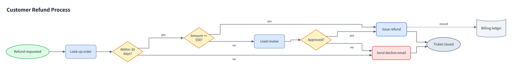
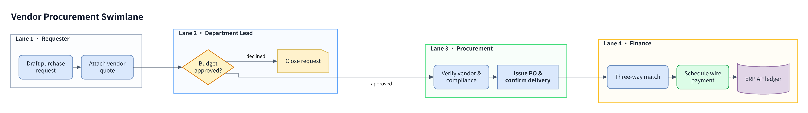
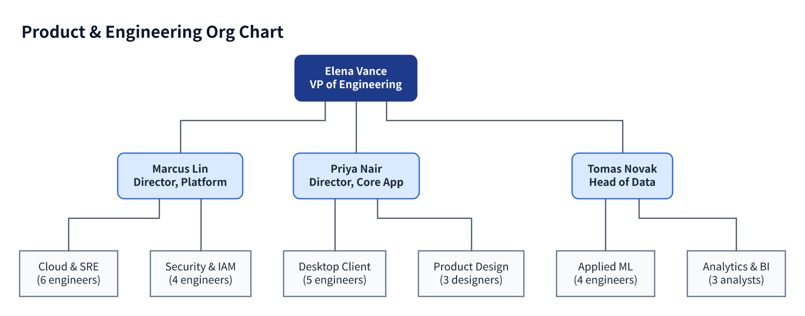
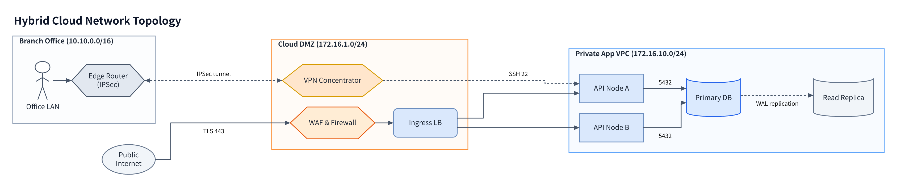
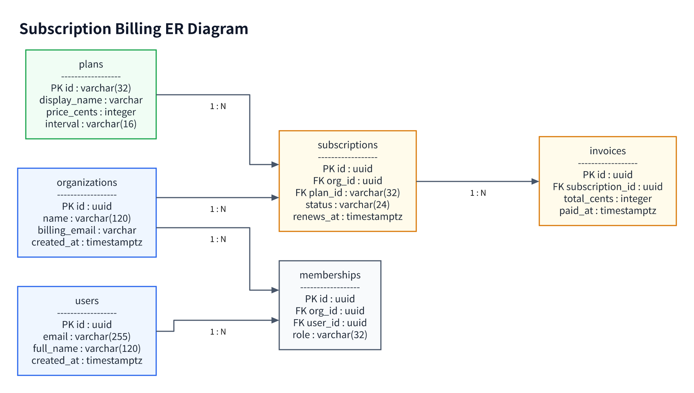
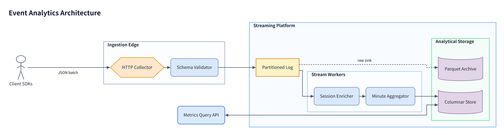
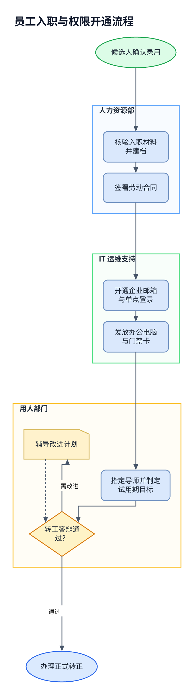
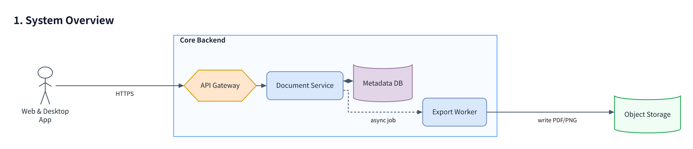
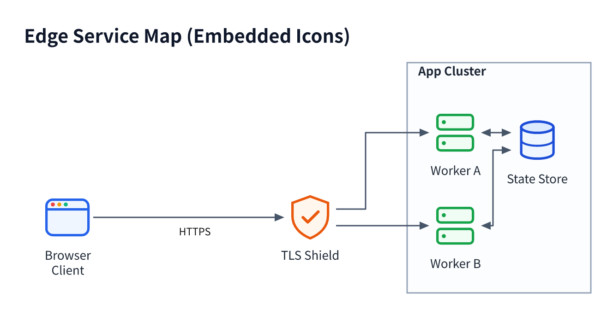

# Sample `.vsdx` Files

Clean-room Microsoft Visio (`.vsdx`) test drawings licensed under [CC BY 4.0](https://creativecommons.org/licenses/by/4.0/), paired with their JSON sources and rendered PNG previews.

Every `.vsdx` package in this directory was generated offline with [vsdx-kit](https://github.com/TopLocalAI/vsdx-kit) (`npx -y vsdx-kit convert`) and verified with [`../tools/inspect_vsdx.py`](../tools/inspect_vsdx.py). Note that each page's shape count includes its diagram title shape and any container headers in addition to node shapes.

## Summary Table

| File | Category & Features Tested | Pages | Shapes | Connectors | Preview |
| --- | --- | ---: | ---: | ---: | --- |
| [`01-basic-flowchart.vsdx`](01-basic-flowchart.vsdx)<br>([JSON](01-basic-flowchart.json)) | Basic flowchart: ellipses, decision diamonds, cylinder, yes/no connector labels, dashed branch | 1 | 11 | 12 | [](01-basic-flowchart.png) |
| [`02-cross-functional-swimlane.vsdx`](02-cross-functional-swimlane.vsdx)<br>([JSON](02-cross-functional-swimlane.json)) | Cross-functional swimlane diagram: 4 department lanes, cross-lane connectors, note & cylinder | 1 | 14 | 8 | [](02-cross-functional-swimlane.png) |
| [`03-org-chart.vsdx`](03-org-chart.vsdx)<br>([JSON](03-org-chart.json)) | Organization chart: top-down hierarchy, custom header fill/font colors, `arrow: "none"` lines | 1 | 11 | 9 | [](03-org-chart.png) |
| [`04-network-topology.vsdx`](04-network-topology.vsdx)<br>([JSON](04-network-topology.json)) | Network topology: subnet containers, actor, firewall hexagons, bidirectional IPSec tunnel, DB replicas | 1 | 15 | 10 | [](04-network-topology.png) |
| [`05-er-diagram.vsdx`](05-er-diagram.vsdx)<br>([JSON](05-er-diagram.json)) | Simple ER diagram: 6 relational table entities with PK/FK attributes and `1 : N` cardinality edges | 1 | 7 | 5 | [](05-er-diagram.png) |
| [`06-grouped-architecture.vsdx`](06-grouped-architecture.vsdx)<br>([JSON](06-grouped-architecture.json)) | Grouped architecture: nested containers (`Stream Workers` & `Analytical Storage` inside `Streaming Platform`) | 1 | 15 | 8 | [](06-grouped-architecture.png) |
| [`07-zh-flowchart.vsdx`](07-zh-flowchart.vsdx)<br>([JSON](07-zh-flowchart.json)) | Chinese-label flowchart (`员工入职与权限开通流程`): CJK text sizing, multi-line labels, containers | 1 | 13 | 9 | [](07-zh-flowchart.png) |
| [`08-multi-page-handbook.vsdx`](08-multi-page-handbook.vsdx)<br>([JSON](08-multi-page-handbook.json)) | Multi-page document: 3 Visio pages (`1. System Overview`, `2. Auth & Token Flow`, `3. Incident Triage`) | 3 | 23 | 16 | [](08-multi-page-handbook.png) |
| [`09-embedded-media-icons.vsdx`](09-embedded-media-icons.vsdx)<br>([JSON](09-embedded-media-icons.json)) | Embedded media icons: `<ForeignData>` image shapes backed by `visio/media/image1..4.png` parts | 1 | 12 | 5 | [](09-embedded-media-icons.png) |

## Regenerating & Inspecting

From the repository root:

```bash
# Regenerate a .vsdx file and its PNG preview from JSON
npx -y vsdx-kit convert samples/01-basic-flowchart.json -o samples/01-basic-flowchart.vsdx
npx -y vsdx-kit preview samples/01-basic-flowchart.json -o samples/01-basic-flowchart.png

# Inspect pages, shapes, connectors, masters, and text labels
python3 tools/inspect_vsdx.py samples/*.vsdx
python3 tools/inspect_vsdx.py --json samples/08-multi-page-handbook.vsdx
```
